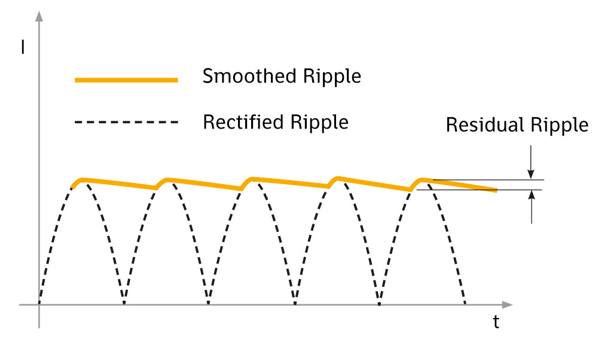

**Ripple** is a small unwanted variation in a DC voltage or current.

Instead of being perfectly constant, the signal slightly rises and falls over time.

# Common Causes

Ripple commonly comes from:

* rectifiers
* switching regulators
* power supplies
* insufficient filtering

# Ripple Voltage

Ripple is often measured using **peak-to-peak voltage**.

$$
V_{\text{ripple(pp)}} = V_{\max} - V_{\min}
$$

For example, if a 5 V supply varies between 4.95 V and 5.05 V:

$$
V_{\text{ripple(pp)}} = 0.10V
$$

# Reducing Ripple

Ripple can be reduced using:

* capacitors
* LC filters
* voltage regulators
* proper PCB layout

# Ripple vs. Noise

* **Ripple** → usually periodic variation caused by power conversion
* **Noise** → general unwanted electrical disturbance

# Key Idea

**Ripple is the small unwanted fluctuation that remains on top of a DC voltage or current.**
