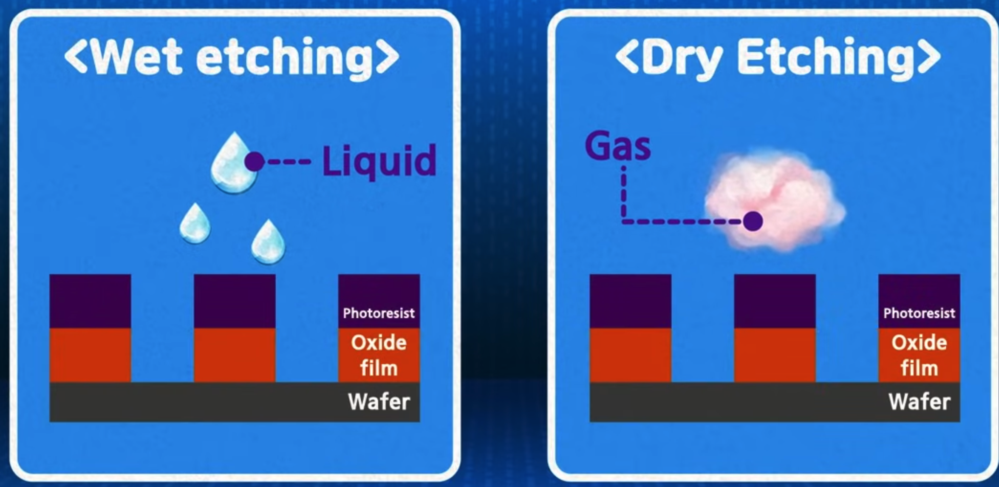
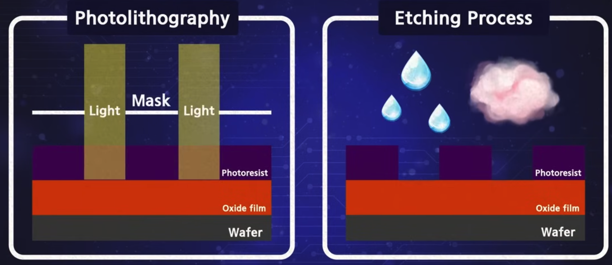
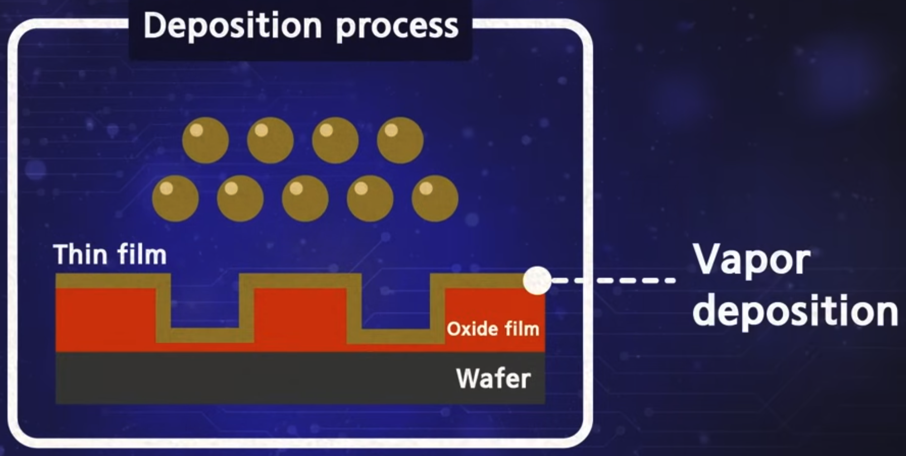
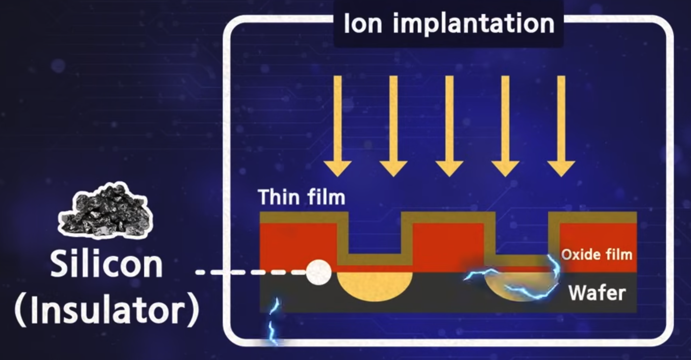

Semiconductor manufacturing is the process of building extremely small electronic components on a silicon wafer.

The major manufacturing steps are often summarized as the **8 major semiconductor processes**.

```text
Wafer Manufacturing
  ↓
Oxidation
  ↓
Photolithography
  ↓
Etching
  ↓
Deposition & Ion Implantation
  ↓
Metal Wiring
  ↓
Electrical Die Sorting (EDS)
  ↓
Packaging.      
```

The first six steps are pre-process, where circuits are created on the wafer.

Testing and packaging are post-process, where individual chips are inspected, separated, and packaged.

# 1. Wafer Manufacturing

A **wafer** is a thin circular piece of semiconductor material, usually silicon.

A wafer is the foundation for the semiconductor. Most wafers are made of silicon extracted from sand. Sand is heated until it melts into a high purity liquid and then gets solidifed by crystalization. The resultant silicon rod is called an ingot(silicon pilar). 
These ingots are sliced into a disc thinly sliced wafers. 

The surface of sliced wafers is rough and contains defects so polishing machines are used to polish the surface of a wafer. The reason is that defects on the surface could negatively affect the precision of circuits. 

Fun Fact: The word wafer comes from biscuit wafers because if you look at a photo of wafers, you can see a grid pattern on the surface. 

A wafer made this way is the main material for semiconductors. The larger the diameter is, the greater the number of chips that can be produced per wafer, so the diameter of wafers is becoming larger. 

```text
Silicon → Ingot → Slice → Wafer
```

The wafer becomes the base on which transistors and circuits are built.

# 2. Oxidation

Oxidation creates a thin layer of silicon dioxide (`SiO₂`) on the wafer surface.

Oxygen or water vapor is sprayed on the wafer surface to form a uniform oxide film. 
This oxide film protects the wafer surface during the following processes and also blocks current leakage between circuits. 
The film acts as a strong protective shield. 

This layer can be used as:

* an electrical insulator
* a protective layer
* part of transistor structures

# 3. Photolithography

Photolithography draws a circuit design onto a wafer. 

It is similar to developing a photo taken on a film camera. With semiconductors, a photomask functions as the film. 
A photomask is a glass substrate with a computer-designed circuit pattern. In order to draw the circuit on the wafer, the photoresist, 
a material that responds to light, is applied thinly and evenly on the oxide film previously placed on the wafer. 
When light transfers the patterned photomask, the circuit is drawn on the wafer surface. 
Just like developing a photo, a circuit pattern is imprinted on the wafer by spraying developer and removing unlit areas from the areas that are exposed to light.
After an inspection of the wafer to check whether the pattern is drawn well, it moves onto the next step. 

```text
Photoresist
    ↓
Mask + Light
    ↓
Circuit pattern on wafer
```

# 4. Etching

Etching removes unwanted material from the wafer.

The photoresist pattern protects areas that should remain.

Unnecessary materials are carved out, so that only the designed pattern remains. 
Using a liquid or gas etchant, unnecessary materials are selectively removed to draw the desired design. 
when chemical solutions are used for etching, it is called wet etching, and when gas or plasma ia used, it is called dry etching. 


```text
Pattern
   ↓
Etching
   ↓
Unwanted material removed
```

Common methods include:

* wet etching
* dry etching



# 5. Deposition and Ion Implantation

## Deposition

Deposition adds extremely thin layers of material onto the wafer.

It's like constructing a building on a semiconductor chip, samller than a fingernail and thinner than a sheet of paper.
The photolithography process and the etching process are repeated several times on the wafer, layer by layer. 

An insulating film that separates and protects the stacked circuits is required. that's called a thin film. 
Coating the thin film at a desired molecular or atomic level onto a wafer is called deposition. 
Since the coating is so thin, precise and sophisticated technology is required to uniformly apply the thin film on a wafer. 

These layers may include:

* insulators
* conductors
* semiconductor materials


## Ion Implantation

Ion implantation adds impurity atoms to silicon.

To give the semiconductor electrical characteristics, ion implementation is also required. 
A semiconductor made of silicon does not conduct electricity, but adding impurities, it conducts current and has conductive properties. 
After all these processes, the wafer becomes conductive and numerous circuits are drawn on it. 

This process is called [[Doping]].

Ion implantation creates:
* N-type regions
* P-type regions

These regions are necessary for building transistors.


# 6. Metal Interconnection

Metal wires are created on the chip to connect transistors and other components.

In order for this circuit to work, an electrical signal must be applied. 
it is necessary to create a path for electricity to pass through according to the circuit pattern. 

This process is called the metal wiring process. It is a process that allows electricity to flow by forming thin metal layers
using materials such as aluminum, titanium, or tungsten, so that electricity can pass through the semiconductor well. 
Copper is commonly used for these connections.

```text
Transistor ── Metal wire ── Transistor
```

Modern chips contain many layers of metal interconnections.

# 7. Testing

The manufactured chips are electrically tested.

EDS (Electrical Die Sorting): the process of testing electrical characteristics to make sure each individual chip has reached the desired quality level, simply, it is a testing step to sort out defective chips 

## Yield

Yield represents the percentage of usable chips produced from a wafer.

$$
\text{Yield}
=
\frac{\text{Number of Working Chips}}
{\text{Total Number of Chips}}
\times 100
$$

A higher yield means more functional chips are produced from each wafer.

Testing checks whether:
* transistors work correctly
* circuits produce the expected output
* defective chips can be identified

Testing may occur both before and after packaging.

# 8. Packaging

Packaging converts individual semiconductor dies into finished chips that can be installed in electronic devices.

The wafer completed in the previous steps are cut into individual semiconductor chips that can be loaded on an electronic device. 
This is called wafer sawing or dicing.
```text
Wafer
   ↓
Dicing
   ↓
Individual Die
   ↓
Package
```

A typical packaging process includes:
```text
Wafer Sawing / Dicing
        ↓
Die Attach (placed on PCB board)
        ↓
Wire Bonding
        ↓
Molding
        ↓
Marking
        ↓
Final Test
```

## Die Attach

The semiconductor die is attached to a package substrate.

## Wire Bonding

Contact point of the semiconductor chip is placed on a substrate is connected with the contact point of the substrate

## Molding

The chip is enclosed in protective material.

This protects the semiconductor from:

* moisture
* dust
* mechanical damage
* external contamination

## Marking

Information such as the product name or identification code is printed on the package.

## Final Test

The packaged semiconductor is tested again to make sure it operates correctly.

# Key Idea

Semiconductor manufacturing repeatedly creates, removes, and modifies extremely thin layers on a silicon wafer.

```text
Create wafer
→ build layers
→ pattern layers
→ remove material
→ dope silicon
→ connect devices
→ test
→ package
```

These processes allow billions of transistors to be manufactured on a single chip.