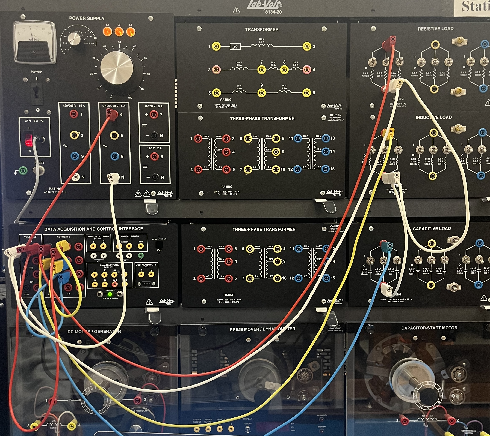

## What we did

We learned to set up the power supply, Data Acquisition Interface (DAI), and Lab-Volt software. We measured a resistor, inductor, and capacitor separately, then connected R–L, R–C, and R–L–C loads in parallel. The metering window showed RMS voltage, RMS branch currents, and real power; the oscilloscope and phasor analyzer showed the phase relationships.

## Our assigned components

| Quantity | Assigned | Measured with DMM |
| --- | ---: | ---: |
| Resistance $R$ | $171.43\,\Omega$ | $172.2\,\Omega$ |
| Inductance $L$ | $1.6\,\mathrm{H}$ | $35.1\,\Omega$ winding resistance |
| Capacitance $C$ | $4.4\,\mu\mathrm{F}$ | $478{,}600\,\Omega$ insulation resistance |

The DMM's resistance setting measures **DC resistance**, not AC reactance. For an ideal inductor, $X_L=2\pi fL$; for an ideal capacitor, $X_C=1/(2\pi fC)$. At $60\,\mathrm{Hz}$, the nominal $1.6\,\mathrm{H}$ inductor has $X_L\approx603\,\Omega$, while the $4.4\,\mu\mathrm{F}$ capacitor has $X_C\approx603\,\Omega$. Both reactances are expressed in ohms because they describe the ratio of AC voltage to AC current. They are distinct from the DMM readings of $35.1\,\Omega$ and $478.6\,\mathrm{k}\Omega$.

## What the measurements taught me

- **R:** Current is approximately in phase with voltage. A resistor consumes real power: ideally $P=V_{\mathrm{rms}}I_{\mathrm{rms}}=V_{\mathrm{rms}}^2/R$.
- **L:** Current lags voltage. The inductor has winding resistance, so a real inductor is not perfectly lossless and its phase shift need not be exactly $90^\circ$.
- **C:** Current leads voltage. A real capacitor has finite insulation resistance; its high DMM resistance does not mean its AC branch current is zero.
- **Parallel loads:** Every connected branch sees approximately the same supply voltage. Adding a branch changes the source current, while the voltage remains near the set value.
- **Current adds as phasors:** $\underline I_{\mathrm{source}}=\underline I_R+\underline I_L+\underline I_C$. Do not add the displayed RMS current magnitudes directly. The inductive and capacitive currents point in opposite reactive directions and can partly cancel.

In our RLC screenshot, the supply read **$59.91\,\mathrm{V}$ RMS**. The R, L, and C branch meters read **$0.346$, $0.102$, and $0.104\,\mathrm{A}$**, while the programmed sum meter read **$0.362\,\mathrm{A}$**. The three magnitudes add to $0.552\,\mathrm{A}$, much larger than the measured source current. This is the clearest evidence from our data that the branch currents must be added with their phase angles. The displayed real power was **$20.72\,\mathrm{W}$**, consistent with most real power coming from the resistive branch ($59.91\times0.346\approx20.73\,\mathrm{W}$). The L and C readings are close, but their cancellation is incomplete in the real circuit.

## Equipment and safety to remember

1. Start with the **main power switch off** and the voltage control knob at **zero**. Have the wiring checked before energizing it; raise the voltage gradually.
2. The separate **24 V control supply** powers the DAI. Its green LED must be on for Lab-Volt to work; this switch is different from the main output switch.
3. Connect an **ammeter in series** with its branch and a **voltmeter in parallel** across the load. Current should enter the DAI ammeter's red terminal; connect the voltmeter's red terminal to the higher potential.
4. Set the Lab-Volt meters to **AC RMS**. Program the additional meter as `I1+I2+I3` to measure the combined source current. Use the oscilloscope for time-domain lead/lag and the phasor analyzer for angles.
5. Turn the main supply off and return the voltage knob to zero before changing branch connections. Do not use the DMM's resistance mode on an energized circuit.

## One-sentence takeaway

**A parallel AC circuit keeps nearly the same voltage across every branch, but its source current depends on the phasor sum of the resistive, inductive, and capacitive branch currents.**
