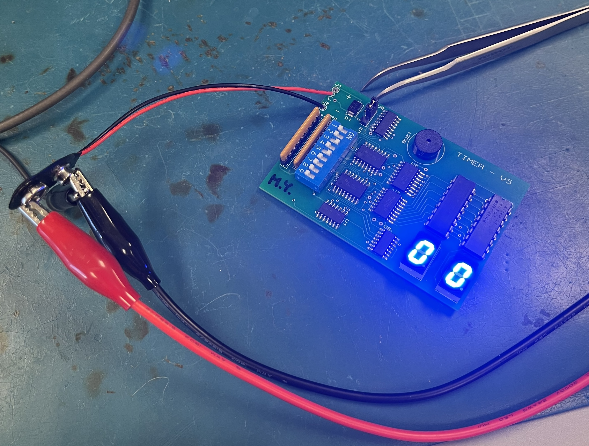
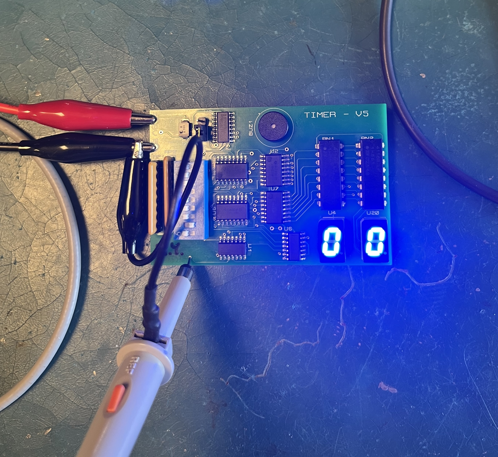
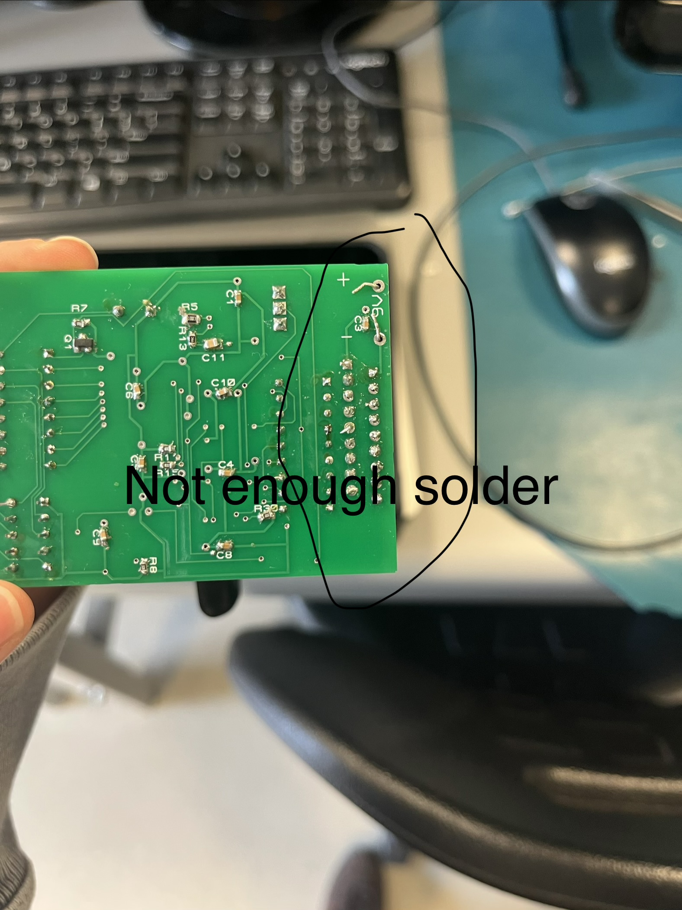

## What This Lab Is About

Lab A introduces PCB assembly by building a digital timer circuit. The timer board contains surface-mount and through-hole components, including logic ICs, seven-segment displays, a DIP switch, resistor networks, a MOSFET, and a buzzer.

After assembly, the PCB is powered, tested, and debugged using laboratory instruments such as a DMM and oscilloscope. The lab also introduces signal tracing and shows how different sections of a digital circuit work together.

## What I Learned

### Identifying and Placing Components

- Components must be installed in their correct PCB locations.
- Some components are polarized or orientation-sensitive, so their pin-1 and polarity markings must be checked before soldering.

### A Good Solder Joint

A good solder joint should:

- Look shiny, smooth, and clean.
- Completely connect the component lead to the PCB pad.
- Have approximately the shape of a tiny **Hershey’s Kiss**.
- Use enough solder to create a secure connection without forming a large blob.
- Not touch neighbouring pads or pins.

A dull, cracked, uneven, or ball-shaped joint may indicate a cold or poorly formed solder joint. Too much solder can create a solder bridge and short adjacent connections.

### Testing and Debugging

- The timer is powered using a 9 V supply.
- In **LOAD mode**, a starting value can be loaded using the DIP switches, and the clock does not run because U8 is held in reset.
- In **RUN mode**, the clock runs and the counters decrement toward `00`.
- When the timer reaches `00`, `COUNT_DONE` activates, the counters stop, and the buzzer circuit is enabled.
- An oscilloscope can be used to observe signals such as `CLOCK`, `BCD_B_COUTn`, `COUNT_DONE`, `BUZZ`, and `BUZZ_Q_R`.

### Buzzer Circuit

- `BUZZ` is a slower control signal that drives the gate of MOSFET Q1.
- When Q1 turns on, it provides a current path through the buzzer.
- `BUZZ_Q_R` is measured at the drain of Q1.
- The buzzer has an internal oscillator that operates much faster to produce sound. This internal oscillator causes the higher-frequency waveform measured at BUZZ_Q_R. 

## Current Progress

- [x] Identified the main PCB components
- [x] Learned how to use a soldering iron and solder wire
- [x] Finished soldering the PCB components
- [x] Inspected the solder joints
- [x] Powered and tested the timer
- [x] Confirmed that the timer counts down to `00`
- [x] Debugged the buzzer circuit
- [x] Confirmed that the buzzer activates
- [x] Practised measuring signals with an oscilloscope

## Probing the Timer Board Using Proteus

- Right-click the net you want to probe in the schematic capture.
- Highlight the net in the PCB layout to locate an accessible probing point.
- Probe that point on the physical board to observe the waveform on the oscilloscope.

## Problems and Troubleshooting

### Buzzer Did Not Initially Work

The timer counted correctly, but the buzzer did not activate at first. When I pressed down on Q1(mosfet), the buzzer started working. This indicated that one or more MOSFET pins were not making a reliable electrical connection with the PCB pads.

The solder joints around Q1 needed to be inspected and corrected. This demonstrated how an incomplete solder joint can cause a circuit to work intermittently when physical pressure is applied.

### Unexpected Fast-Clock Measurement

The slow clock mode measured correctly at approximately 1 Hz. However, the fast mode measured approximately 34 Hz instead of the expected 16 Hz. 

### Feedback from Lab Instructor

