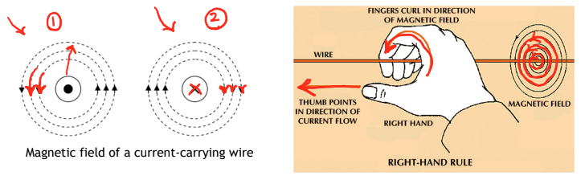
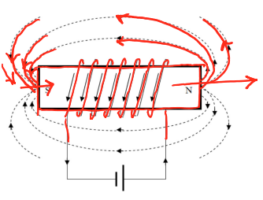
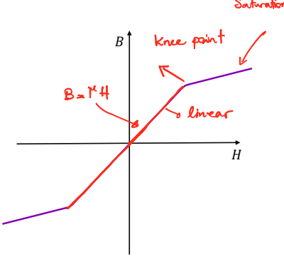
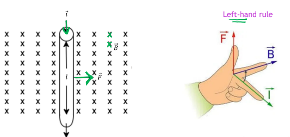

> **Module topics:** Magnetic fields, induced electromagnetic forces, magnetic properties of materials, magnetization characteristics, hysteresis loops, eddy currents, leakage flux, magnetic circuit analysis, Faraday’s law, and Lenz’s law.

## Why magnetic fields matter

Magnetic fields allow energy to be converted or transferred in electrical devices:

- **Motors:** electrical energy → mechanical energy.
- **Generators:** mechanical energy → electrical energy.
- **Transformers:** energy transfers between electrical circuits through a changing magnetic field.

A magnetic field can be produced by a **permanent magnet** or by **electric current**.

## Permanent magnets and magnetic flux

A **permanent magnet** is a ferromagnetic material that retains its magnetism for a long time after being magnetized. It has a north pole and a south pole.

Magnetic field lines form **closed loops**:

- Outside the magnet, they travel from **north to south**.
- Inside the magnet, they return from **south to north**.

**Magnetic flux**, represented by $\phi$, describes the total magnetic field passing through a chosen surface. Field lines are a visualization of flux, rather than physical objects being counted.

$$
\text{Unit of magnetic flux: weber (Wb)}
$$

> [!tip] Flux versus flux density
> **Flux** describes the total through an area. **Flux density** describes how concentrated that flux is.

## Magnetic field around a current-carrying wire

Current flowing through a straight wire creates a magnetic field in **concentric circles around the wire**. The field becomes weaker farther from the wire.

### Right-hand grip rule for a straight wire

1. Point your **right thumb** along the conventional current direction.
2. Your **curled fingers** show the magnetic field direction around the wire.

| Current direction | Symbol | Magnetic field direction, viewed on the page |
|---|---|---|
| Out of the page, toward you | $\odot$ | Counterclockwise |
| Into the page, away from you | $\otimes$ | Clockwise |

Think of a dot as the tip of an arrow coming toward you, and a cross as the tail of an arrow going away.

> [!warning] Read arrows carefully
> An arrow along the wire indicates current. Circular arrows around it indicate the magnetic field. The field around a straight wire is perpendicular to the wire, rather than pointing along it.

## Electromagnets and solenoids

A **solenoid** is a coil of wire. Current in its turns produces magnetic fields that reinforce one another inside the coil. 

The illustrated electromagnet contains:

- A ferromagnetic core.
- A winding with $N$ turns.
- A current $I$ through the winding.

Its field can be controlled electrically:

- Increasing current generally increases the field, although the core can eventually saturate.
- Increasing the number of turns increases the magnetizing effect for the same current.
- Reversing current reverses the field and swaps the poles.

### Right-hand grip rule for a coil

1. Curl your **right fingers** in the direction of current around the turns.
2. Your **thumb** points along the magnetic field **inside the coil**, toward its north end.

| Application | Thumb represents | Curled fingers represent |
|---|---|---|
| Straight wire | Current | Magnetic field around the wire |
| Coil | Magnetic field inside the coil | Current around the turns |

### Hard versus soft magnetic materials

| Material | Main magnetic property | Typical use |
|---|---|---|
| **Hard magnetic** | Retains magnetism and resists demagnetization | Permanent magnets |
| **Soft magnetic** | Easily magnetized and demagnetized | Transformer and electric-machine cores |

Soft magnetic materials are useful when the field must follow changes in the winding current. Here, “hard” and “soft” describe magnetic behaviour, not mechanical hardness.

## Magnetic flux density: B

Magnetic flux density describes the amount of flux per unit area. For a uniform field perpendicular to the cross section:

$$
\boxed{B=\frac{\phi}{A}}
$$

Equivalently:

$$
\boxed{\phi=BA}
$$

| Symbol | Meaning | SI unit |
|---|---|---|
| $B$ | Magnetic flux density | Tesla (T) |
| $\phi$ | Magnetic flux | Weber (Wb) |
| $A$ | Cross-sectional area perpendicular to the flux | Square metre ($\mathrm{m^2}$) |

$$
1\ \mathrm T=1\ \mathrm{Wb/m^2}
$$

For a fixed flux, a smaller area gives a larger flux density: the same flux is more concentrated.

### Choosing the area

Imagine cutting straight across the path of the flux. The exposed face is the cross-sectional area.

- **Vertical flux in a core leg:** area = leg width × core depth.
- **Horizontal flux in a top or bottom section:** area = section thickness × core depth.

## Magnetic field intensity: H

**Magnetic field intensity**, $H$, describes the magnetizing effort produced by current. 

Its unit is **A/m**, often written **ampere-turns per metre** in winding calculations.

### Ampère’s law

For the magnetic-circuit conditions considered here:

$$
\boxed{\oint\mathbf H\cdot d\mathbf l=I_{\text{enclosed, net}}}
$$

This means: add up the component of $H$ along a complete closed path. The result equals the net current linked by that path.

If the path links $N$ turns, each carrying current $I$ in the same winding sense:

$$
I_{\text{enclosed, net}}=NI
$$

If $H$ is tangent to the path and approximately constant along it:

$$
H\oint dl=NI
$$

Since the total path length is $l$:

$$
Hl=NI
$$

$$
\boxed{H=\frac{NI}{l}}
$$

| Symbol | Meaning | Unit |
|---|---|---|
| $N$ | Number of winding turns | Turns |
| $I$ | Current in the winding | A |
| $l$ | Mean magnetic path length | m |
| $H$ | Magnetic field intensity | A/m |

The product $NI$ is called **magnetomotive force (MMF)**. The same current is counted $N$ times because the magnetic path links $N$ turns; it does not mean the wire itself carries $NI$ amperes.

### Mean magnetic path length

Measure along the **centreline of the core**, halfway between its inner and outer edges.

For a rectangular vertical leg:

$$
l_{\text{leg}}=\frac{t_{\text{top}}}{2}+h_{\text{window}}+\frac{t_{\text{bottom}}}{2}
$$

The half-thicknesses appear because the path turns at the **middle** of the top and bottom sections.

> [!warning] When H is not uniform
> Do not assign the same $H=NI/l$ to every section of a core with different areas or an air gap. Apply Ampère’s law section by section:
>
> $$
> \sum_i H_i l_i=NI
> $$

## Distinguishing flux, flux density, and field intensity

| Quantity | Question it answers | Key relation |
|---|---|---|
| Flux $\phi$ | How much magnetic flux passes through the section? | $\phi=BA$ |
| Flux density $B$ | How concentrated is the flux? | $B=\phi/A$ |
| Field intensity $H$ | How much magnetizing effort is applied per unit path length? | $H=NI/l$ for a uniform path |

## Magnetic circuits and magnetomotive force

A **magnetic circuit** provides a path for magnetic flux, usually through a ferromagnetic core. Current in a winding creates the **magnetomotive force (MMF)** that establishes this flux.

$$
\boxed{\mathcal F=NI}
$$

For a uniform magnetic path:

$$
\boxed{\mathcal F=Hl}
$$

MMF is measured in **ampere-turns (A·turns)**. It represents the total magnetizing effort, while $H$ represents the effort per unit path length.

Most flux follows the core because the core offers much less **reluctance** than the surrounding air. Assuming all flux stays in the core is an idealization; some leakage occurs in practice.

### Analogy with an electric circuit

| Electric circuit | Magnetic circuit |
|---|---|
| EMF or voltage $V$ | MMF $\mathcal F$ |
| Current $I$ | Flux $\phi$ |
| Resistance $R$ | Reluctance $\mathcal R$ |
| $V=RI$ | $\mathcal F=\mathcal R\phi$ |

This analogy helps with calculations, but magnetic flux is not a flow of particles like electric current.

## Reluctance and permeability

**Reluctance** describes how strongly a magnetic path opposes the establishment of flux.

$$
\boxed{\mathcal F=\mathcal R\phi}
$$

Therefore:

$$
\boxed{\phi=\frac{NI}{\mathcal R}}
$$

For a uniform section:

$$
\boxed{\mathcal R=\frac{l}{\mu A}}
$$

| Symbol | Meaning | Unit |
|---|---|---|
| $\mathcal R$ | Reluctance | A·turns/Wb |
| $l$ | Mean magnetic path length | m |
| $A$ | Cross-sectional area perpendicular to flux | $\mathrm{m^2}$ |
| $\mu$ | Permeability of the material | H/m |

**Permeability** describes how readily a material supports magnetic flux:

$$
\boxed{\mu=\mu_0\mu_r}
$$

- $\mu_0$: permeability of free space; use $4\pi\times10^{-7}\ \mathrm{H/m}$ in these calculations.
- $\mu_r$: relative permeability, a dimensionless material property.
- For air, $\mu_r\approx1$, so $\mu\approx\mu_0$.

| Change, with other quantities fixed | Effect on reluctance |
|---|---|
| Longer path $l$ | Increases |
| Larger cross-sectional area $A$ | Decreases |
| Higher permeability $\mu$ | Decreases |

> [!tip] Why use an iron core?
> High permeability gives low reluctance, allowing a larger flux for the same coil MMF.

For a fixed geometry, reluctance is approximately constant in non-magnetic materials such as air. In ferromagnetic materials, permeability changes with the magnetic operating point, so reluctance is generally **not constant**.

## Magnetization characteristics: the B–H curve

The **magnetization characteristic** describes the relationship between applied field intensity $H$ and the resulting flux density $B$.

Combining the magnetic-circuit equations:

$$
B=\frac{\phi}{A}
=\frac{\mathcal F}{\mathcal R A}
=\frac{Hl}{\left(l/(\mu A)\right)A}
=\mu H
$$

$$
\boxed{B=\mu H}
$$

A material with high permeability can produce a large $B$ from a relatively small $H$.

### Non-magnetic versus ferromagnetic materials

| Property | Non-magnetic material, such as air | Ferromagnetic material |
|---|---|---|
| $B$–$H$ relationship | Approximately linear | Generally nonlinear |
| Permeability | Small and approximately constant | High in the useful region; varies with operating point |
| Flux density for the same $H$ | Small | Usually much larger |

For a linear material, the slope of the $B$–$H$ line equals $\mu$. For a nonlinear material, $B/H$ gives the permeability at the chosen operating point; the local tangent slope $dB/dH$ describes the response to a small change in $H$.

### Magnetic domains and saturation

Ferromagnetic materials contain small regions called **magnetic domains**, each behaving like a tiny magnet.

1. In an unmagnetized material, domains point in different directions, largely cancelling their effects.
2. Applying current to a coil creates a magnetizing field that encourages alignment with that field.
3. Increasing current increases alignment and flux density.
4. Once most domains are aligned, the core approaches **saturation**.

> [!important] Saturation
> In saturation, a large increase in current or $H$ produces only a small increase in $B$. The curve becomes much flatter; $B$ does not become perfectly constant.

### Regions of the magnetization curve

| Region | Behaviour |
|---|---|
| Approximately linear region | $B$ increases strongly with $H$; permeability can be approximated as constant over this region |
| Knee | Transition where the curve starts flattening |
| Saturation region | Additional $H$ produces relatively little additional $B$ |

Electric machines often operate **near the knee** to achieve high flux density while avoiding deep saturation. High flux helps produce motor torque or generator EMF, but increasing current far into saturation gives little additional magnetic benefit.

### Using a magnetization curve in calculations

When permeability is not given as constant, use the material’s curve. For a uniform core without an air gap:

1. Calculate the field intensity:

$$
H=\frac{NI}{l}
$$

2. Read the corresponding $B$ from the curve.
3. Calculate the flux:

$$
\phi=BA
$$

If relative permeability at that operating point is required:

$$
\boxed{\mu_r=\frac{B}{\mu_0H}}
$$

This value applies at the selected operating point; it is not necessarily valid elsewhere on the curve.

## Hysteresis loop

In AC machines and transformers, the winding current changes with time, so the magnetic field intensity $H$ and flux density $B$ also change.

For an ideal **non-magnetic material**, $B$ follows $H$ along the same straight line as the field increases and decreases. For a **ferromagnetic material**, $B$ depends on both the present value of $H$ and the material’s previous magnetization. This magnetic memory is called **hysteresis**.

### Reading the loop

Starting from positive saturation:

1. Reduce $H$ to zero: some flux density remains, called **remanence** or **residual flux density**, $B_r$.
2. Apply a reverse field: $B$ reaches zero at $H=-H_c$, where $H_c$ is the magnitude of the **coercive field**.
3. Increase the reverse field: the material approaches negative saturation.
4. Bring $H$ back to zero: a negative residual flux density remains.
5. Apply a positive field: $B$ reaches zero at $H=+H_c$, then rises toward positive saturation.

The material traces a complete loop during each steady AC excitation cycle.

> [!important] Removing current does not necessarily remove magnetism
> At $H=0$, a previously magnetized core can still have nonzero $B$. A reverse field is required to bring $B$ to zero on the hysteresis loop.

Residual magnetism can help initiate voltage build-up in some self-excited generators.

## Hysteresis losses

Reversing the magnetization requires energy. Some of this energy is not recovered when the field is reduced and is dissipated as **heat**.

The **area enclosed by the B–H loop** represents energy lost **per cycle per unit volume**. A larger loop means greater loss.

| Material | Hysteresis behaviour | Typical use |
|---|---|---|
| Soft magnetic | Narrow loop; low coercive field; easier to reverse magnetization | Transformer and motor cores |
| Hard magnetic | Wider loop; resists demagnetization; retains magnetism | Permanent magnets |

The lecture’s empirical hysteresis power-loss model is:

$$
\boxed{P_h=k_hVB_{\max}^{\,n}f}
$$

| Symbol | Meaning |
|---|---|
| $P_h$ | Hysteresis power loss (W) |
| $k_h$ | Material-dependent hysteresis constant |
| $V$ | Core volume ($\mathrm{m^3}$), **not voltage** |
| $B_{\max}$ | Peak flux density (T) |
| $f$ | Excitation frequency (Hz) |
| $n$ | Empirical material exponent, typically 1.5–2.5 |

At fixed peak flux density, doubling the frequency doubles the hysteresis power loss: the core goes through twice as many cycles per second.

## Eddy currents and eddy-current losses

**Eddy currents** are circulating electrical currents induced inside a conducting core by a changing magnetic flux.

Their origin is:

1. AC winding current produces changing flux.
2. Changing flux induces an EMF in the core material (**Faraday’s law**).
3. Because the core conducts electricity, this EMF drives circulating currents.
4. The core’s resistance causes $I^2R$ heating.

The current loops lie in planes approximately perpendicular to the magnetic flux. Their magnetic fields oppose the **change in flux** that caused them (**Lenz’s law**).

### Reducing eddy currents with laminations

AC machine and transformer cores commonly use thin steel sheets called **laminations**, electrically insulated from one another by varnish or another insulating layer.

- The insulation interrupts large current loops through the core.
- Thin sheets restrict the size of the remaining loops, reducing heating.
- The main magnetic flux travels approximately parallel to the broad faces of the sheets.
- The slides give a typical sheet thickness of **0.35–0.5 mm**.

The eddy-current loss model is:

$$
\boxed{P_e=k_eV(ftB_{\max})^2}
$$

Here, $k_e$ is a material-dependent constant, $V$ is core volume, and $t$ is **lamination thickness**, not time.

$$
P_e\propto f^2t^2B_{\max}^2
$$

## Total core losses

In the lecture’s model:

$$
\boxed{P_{\text{core}}=P_h+P_e}
$$

| Loss | Main cause | Main way to reduce it |
|---|---|---|
| Hysteresis | Repeated reversal of magnetization | Choose soft magnetic material with a narrow loop |
| Eddy currents | Currents induced within the conducting core | Use thin, electrically insulated laminations |

Both losses heat the core. Higher flux density or frequency can increase heating beyond the device’s design limits.

### Useful scaling relationships

Holding all other quantities constant:

| Change | Hysteresis loss | Eddy-current loss |
|---|---|---|
| Double frequency | $\times2$ | $\times4$ |
| Double peak flux density | $\times2^n$ | $\times4$ |
| Halve lamination thickness | Unchanged in this model | $\times\frac14$ |

> [!warning] Check what stays constant
> The frequency comparisons assume $B_{\max}$ stays fixed. If changing frequency also changes flux density, account for both effects.

## Leakage flux

**Leakage flux** follows a path outside the intended main magnetic circuit, often closing through air near the winding instead of following the complete core path.

- Not all flux produced by the winding contributes to the useful main flux.
- Leakage can increase the excitation needed to obtain a specified useful flux in a practical magnetic circuit.
- Placing windings close to the core, including in slots in electric machines, helps reduce leakage.

In a simple flux accounting model:

$$
\phi_{\text{total}}=\phi_{\text{main}}+\phi_{\text{leakage}}
$$

## Fringing at an air gap

**Fringing** is the outward spreading of the main magnetic field as it crosses an air gap. It increases the gap’s **effective cross-sectional area**:

$$
A_{g,\text{effective}}>A_{\text{core}}
$$

Neglecting leakage, the same main flux passes through the core and gap:

$$
\phi_g=\phi_{\text{core}}=\phi
$$

Therefore, the average gap flux density is lower:

$$
B_g=\frac{\phi}{A_{g,\text{effective}}}
<\frac{\phi}{A_{\text{core}}}=B_{\text{core}}
$$

| Effect | What happens |
|---|---|
| Leakage | Flux takes an alternative path outside the complete main circuit |
| Fringing | Main flux spreads outward while crossing an air gap |

Larger gaps generally make leakage and fringing more significant. Keeping gaps small limits these effects and reduces gap reluctance.

### Accounting for fringing

For a rectangular core cross section with width $w$, depth $d$, and gap length $l_g$, the lecture uses the approximation:

$$
\boxed{A_{g,\text{effective}}\approx(w+l_g)(d+l_g)}
$$

If a question instead specifies a percentage increase, use that directly. For example, a 5% increase gives:

$$
A_{g,\text{effective}}=1.05A_{\text{core}}
$$

Use the effective area for **gap reluctance and gap flux density**. Continue using the physical core area for the iron.

## Magnetic circuit analysis

Magnetic circuits can be analysed using rules analogous to electric circuits.

| Electric quantity | Magnetic counterpart |
|---|---|
| Voltage $V$ | MMF $\mathcal F=NI$ |
| Current $I$ | Flux $\phi$ |
| Resistance $R$ | Reluctance $\mathcal R$ |
| Current density $J=I/A$ | Flux density $B=\phi/A$ |
| Electric field intensity $E$ | Magnetic field intensity $H$ |
| Conductivity $\sigma$ | Permeability $\mu$ |

The magnetic equivalent of Ohm’s law is:

$$
\boxed{\mathcal F=\mathcal R\phi}
$$

### Series paths

With negligible leakage, sections in series carry the **same flux**, and their reluctances add:

$$
\boxed{\mathcal R_{\text{series}}=\mathcal R_1+\mathcal R_2+\cdots}
$$

Their flux densities can differ if their areas differ:

$$
B_i=\frac{\phi}{A_i}
$$

### Parallel paths

Flux splits between branches. Parallel branches have the **same MMF drop**:

$$
\boxed{\frac{1}{\mathcal R_{\parallel}}
=\frac{1}{\mathcal R_1}+\frac{1}{\mathcal R_2}+\cdots}
$$

For two branches:

$$
\mathcal R_{\parallel}
=\frac{\mathcal R_1\mathcal R_2}{\mathcal R_1+\mathcal R_2}
$$

The branch with lower reluctance carries more flux.

### Magnetic equivalents of KCL and KVL

**At a junction:** total incoming flux equals total outgoing flux.

$$
\boxed{\sum\phi_{\text{in}}=\sum\phi_{\text{out}}}
$$

**Around a closed path:** applied MMF equals the sum of MMF drops.

$$
\boxed{\sum(NI)_{\text{signed}}=\sum_i H_i l_i
=\sum_i\mathcal R_i\phi_i}
$$

Coils that drive flux in the same circulation direction have adding MMFs; opposing coils have subtracting MMFs.

> [!warning] Linear versus nonlinear analysis
> Treat reluctances as fixed only when permeability is assumed constant. For a nonlinear core, use its B–H curve to determine each section’s $H$ and apply the MMF balance.

## Magnetic circuit with an air gap

For one core path and one air gap, neglecting leakage:

$$
\mathcal R_m=\frac{l_m}{\mu_0\mu_rA_m}
$$

$$
\mathcal R_g=\frac{l_g}{\mu_0A_{g,\text{effective}}}
$$

The core and gap are in series:

$$
\boxed{\mathcal R_{\text{total}}=\mathcal R_m+\mathcal R_g}
$$

$$
\boxed{\phi=\frac{NI}{\mathcal R_m+\mathcal R_g}}
$$

Then:

$$
B_m=\frac{\phi}{A_m},\qquad
B_g=\frac{\phi}{A_{g,\text{effective}}}
$$

If the required flux is given, solve for current:

$$
\boxed{I=\frac{\phi(\mathcal R_m+\mathcal R_g)}{N}}
$$

Because air has much lower permeability than iron, even a short gap can contribute substantial reluctance. Adding a gap therefore decreases flux at fixed current, or requires more current to maintain the same flux.

> [!tip] Calculation checklist
> - Convert lengths to metres and areas to square metres.
> - Use centreline lengths for the magnetic path.
> - If the mean path includes a gap, subtract its length to obtain the iron-only length $l_m$.
> - Use $\mu_0\mu_r$ for iron and $\mu_0$ for air.
> - Include every gap encountered along the chosen path.
> - Apply fringing corrections to the gap area only.

## Why air gaps are used

Air gaps are necessary in rotating electric machines to provide clearance between the **rotor** (rotating part) and **stator** (stationary part).

They can also be added intentionally to make the overall **flux–current relationship more nearly linear** over a wider current range. The gap adds an approximately constant reluctance, making the total reluctance less sensitive to changes in the core’s permeability.

> [!important] Effect of an air gap
> A gap requires more MMF to produce the same flux. It does not change the iron’s intrinsic B–H curve or eliminate saturation; it allows a larger current before the core reaches a given flux density.

## Induced electromotive force (EMF)

**Electromotive force (EMF)** is an induced voltage, measured in **volts**, despite the word “force” in its name.

| Mechanism | What produces the EMF? | Example |
|---|---|---|
| Changing flux through a stationary winding | Time-varying magnetic field | Transformer; stationary stator windings exposed to a rotating field in a synchronous generator |
| Motion of a conductor through a field | Magnetic force on charges moving with the conductor | Motional EMF in a generator |

A synchronous generator still involves mechanical rotation; its stationary windings experience a changing magnetic field because the rotor turns.

## Faraday’s law of induction

A changing magnetic flux linking a coil induces a voltage:

$$
\boxed{e=-N\frac{d\phi}{dt}=-\frac{d\lambda}{dt}}
$$

**Flux linkage** accounts for the number of turns linked by the flux:

$$
\boxed{\lambda=N\phi}
$$

This assumes the same flux links every turn and $N$ is constant.

| Symbol | Meaning | Unit |
|---|---|---|
| $e$ | Induced EMF | V |
| $N$ | Number of turns | Turns |
| $\phi$ | Flux through each turn | Wb |
| $\lambda$ | Flux linkage | Wb·turns |
| $d\phi/dt$ | Rate of change of flux | Wb/s |

- More turns give more induced voltage for the same flux-change rate.
- Faster flux change gives a larger induced voltage.
- Constant flux linkage produces **zero induced EMF**, even if the flux is large.

For a linear change in flux over a time interval:

$$
|e|=N\frac{|\Delta\phi|}{\Delta t}
$$

## Lenz’s law

The induced voltage has a polarity such that, **if the circuit is closed**, the resulting current produces a magnetic field that opposes the **change in the original flux**.

| Original flux | Induced field acts to… | Direction relative to the original field |
|---|---|---|
| Increasing in magnitude | Resist the increase | Opposite |
| Decreasing in magnitude | Resist the decrease | Same |
| Constant linkage | No induction from flux change | No induced EMF |

> [!warning] Opposes the change, not always the field
> If the original field is decreasing, the induced field supports it to resist that decrease.

To determine the induced current direction:

1. Identify the original flux direction.
2. Determine whether its magnitude is increasing or decreasing.
3. Choose the induced field direction that opposes that change.
4. Apply the coil right-hand grip rule to find the current direction.

An open-circuit coil can have an induced voltage even though no sustained load current flows.

## Motional EMF

When a conductor moves through a magnetic field, magnetic forces separate its positive and negative charges, creating a voltage between its ends.

The magnetic force on a positive charge follows:

$$
\mathbf F_q=q(\mathbf v\times\mathbf B)
$$

For a straight conductor in a uniform field and moving with uniform velocity, the motional EMF along its directed length is:

$$
e=(\mathbf v\times\mathbf B)\cdot\mathbf l
$$

When velocity, field, and conductor length are mutually perpendicular:

$$
\boxed{|e|=Blv}
$$

| Symbol | Meaning | Unit |
|---|---|---|
| $B$ | Magnetic flux density | T |
| $l$ | Active conductor length in the field | m |
| $v$ | Conductor speed | m/s |

Larger field, active length, or speed gives a larger voltage in this geometry. Multiple turns can increase the total induced voltage when their contributions add.

## Force on a current-carrying conductor

A wire carrying current in an external magnetic field experiences a force:

$$
\boxed{\mathbf F=I\mathbf l\times\mathbf B}
$$

The directed length $\mathbf l$ points along **conventional current**. For a straight wire in a uniform field:

$$
\boxed{F=IlB\sin\theta}
$$

Here, $\theta$ is the angle between current and magnetic field.

| Orientation | Force magnitude |
|---|---|
| Perpendicular: $\theta=90^\circ$ | $F=IlB$ (maximum) |
| Parallel or antiparallel: $\theta=0^\circ$ or $180^\circ$ | $F=0$ |

Force is measured in **newtons (N)** and is perpendicular to both the current and the magnetic field.

### Determining force direction

Use **Fleming’s left-hand motor rule** with three mutually perpendicular fingers:

- **First/index finger:** magnetic field $B$.
- **Second/middle finger:** conventional current $I$.
- **Thumb:** force $F$.

For the example, current is downward and the magnetic field is into the page, so the force is **rightward**.

Reversing either current or field reverses the force. Reversing both leaves the force direction unchanged.

## Choosing the correct equation

| Given situation | Equation | What it finds |
|---|---|---|
| Changing flux through a coil | $e=-N\,d\phi/dt$ | Induced voltage |
| Conductor moving through a field, perpendicular geometry | $e=Blv$ | Motional voltage |
| Current-carrying wire in a field | $F=IlB\sin\theta$ | Mechanical force |
