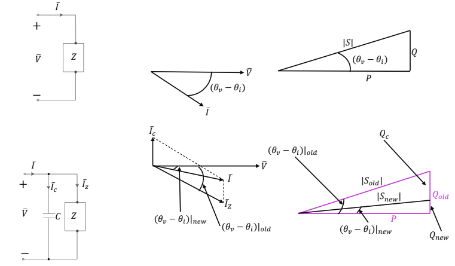

### Why correct power factor?

For a given active power and supply voltage,

$$
P=VI\mathrm{PF}
\qquad\Rightarrow\qquad
I=\frac{P}{V\mathrm{PF}}
$$

A lower power factor means the supply must provide **more current** to deliver the same active power. More current increases line losses and uses more of the line’s current capacity.

The goal of power factor correction is to supply the load’s reactive power **locally**, reducing the reactive current drawn from the source.

### Correcting an inductive load

An inductive load draws positive reactive power and has a *lagging* power factor. A capacitor connected in parallel supplies negative reactive power:

$$
Q_{\text{new}}=Q_{\text{load}}+Q_C
$$

For **unity power factor**, the source supplies no net reactive power:

$$
Q_{\text{new}}=0
\qquad\Rightarrow\qquad
Q_C=-Q_{\text{load}}
$$

In the phasor diagram, the capacitor current leads the voltage. It partly cancels the load’s lagging current, so the **source current becomes smaller and closer to being in phase with the voltage**. The load itself still draws its original current.

