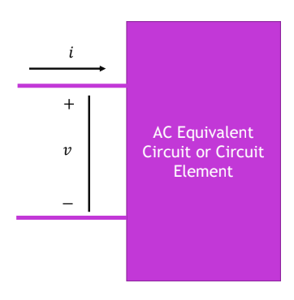

## Single-phase sinusoidal AC

$$
v(t)=V_{\max}\cos(\omega t)=\sqrt{2}V\cos(\omega t)
$$

$$
i(t)=I_{\max}\cos(\omega t-\Phi)=\sqrt{2}I\cos(\omega t-\Phi)
$$

- Lowercase $$v(t)$$ and $$i(t)$$ are **instantaneous values**; uppercase $$V$$ and $$I$$ are **RMS values**.

## RMS versus Average

For a sinusoid,

$$
V_{\mathrm{RMS}}=\sqrt{\frac{1}{T}\int_0^T v^2(t)\,dt}
=\frac{V_{\max}}{\sqrt{2}}
$$

$$
V_{\mathrm{ave}}=\frac{1}{T}\int_0^T v(t)\,dt=0
$$

**Remember:** The average over a full cycle is zero because the positive and negative halves cancel. The RMS value is nonzero and tells us the equivalent DC voltage for resistive heating.

## Phasors and Impedance

A **phasor** represents a sinusoid using its RMS magnitude and phase angle.

$$
v(t)=\sqrt{2}V\cos(\omega t)
\quad\longleftrightarrow\quad
\overline V=V\angle 0^\circ
$$

$$
i(t)=\sqrt{2}I\cos(\omega t-\phi)
\quad\longleftrightarrow\quad
\overline I=I\angle(-\phi)
$$

- The phasor magnitudes are **RMS values**, not peak values.
- In this example, current has a negative angle, so it **lags** voltage by $$\phi$$.
- Positive phasor angles are measured counterclockwise.

### Phasor Ohm’s law

For voltage and current with arbitrary phase angles,

$$
\overline V=V\angle\theta_v,
\qquad
\overline I=I\angle\theta_i
$$

$$
Z=\frac{\overline V}{\overline I}
=\frac{V}{I}\angle(\theta_v-\theta_i)
$$

The impedance magnitude gives the voltage-to-current ratio. Its angle gives the phase difference between voltage and current.

### Impedance of circuit elements

| Element | Impedance |
| --- | --- |
| Resistor | $$Z_R=R$$ |
| Inductor | $$Z_L=j\omega L=jX_L$$ |
| Capacitor | $$Z_C=\dfrac{1}{j\omega C}=-jX_C,\qquad X_C=\dfrac{1}{\omega C}$$ |

For a **series RLC circuit**, add the impedances:

$$
Z=R+jX_L-jX_C=R+j(X_L-X_C)
$$

- If $$X_L>X_C$$, the circuit is net **inductive** and current lags voltage.
- If $$X_C>X_L$$, the circuit is net **capacitive** and current leads voltage.
- If $$X_L=X_C$$, the reactances cancel and voltage and current are in phase.

**Remember:** Convert the sinusoidal source to a phasor, replace components with impedances, then solve using $$\overline V=Z\overline I$$.

## Power in Single-Phase AC Circuits

### Instantaneous and average power

**Instantaneous power** is the voltage across a load multiplied by the current entering it:

$$
p(t)=v(t)i(t)
$$

- Positive power means the load is **absorbing** energy at that instant.
- Negative power means the load is **returning** energy at that instant.

For sinusoidal voltage and current, using RMS values:

$$
v(t)=\sqrt{2}V\cos(\omega t)
$$

$$
i(t)=\sqrt{2}I\cos(\omega t-\phi)
$$

Their product can be written as:

$$
p(t)=VI\cos\phi+VI\cos(2\omega t-\phi)
$$

The second term oscillates and averages to zero over a full cycle. Therefore, the **average (real) power** is:

$$
P=\frac{1}{T}\int_0^T p(t)\,dt=VI\cos\phi
$$

### What different loads do

| Load | Current relative to voltage | Average power |
| --- | --- | --- |
| Pure resistor | In phase | $$P=VI=\dfrac{V^2}{R}=I^2R$$ |
| Pure inductor | Lags by $$90^\circ$$ | $$P=0$$ |
| Pure capacitor | Leads by $$90^\circ$$ | $$P=0$$ |

- A **resistor** absorbs power throughout the cycle, so its instantaneous power never goes negative.
- An **ideal inductor or capacitor** alternately absorbs and returns energy. Its positive and negative power portions cancel over a full cycle.
- For a load with both resistance and reactance, the power graph goes above and below zero, but its average can still be positive.

**Remember:** The voltage and current waves each oscillate at frequency $$\omega$$, while instantaneous power has an oscillating term at $$2\omega$$.

## Active, Reactive, and Complex Powerx

The instantaneous power can be separated into two parts:

$$
p(t)=P[1+\cos(2\omega t)]+Q\sin(2\omega t)
$$

### Active and reactive power

$$
P=VI\cos\phi
\qquad\text{(active or real power, W)}
$$

$$
Q=VI\sin\phi
\qquad\text{(reactive power, VAR)}
$$

- **Active power** is the average power absorbed by the load. In a resistor, it becomes heat; it can also perform useful work in devices such as motors.
- **Reactive power** describes energy being stored and returned by inductors or capacitors. Its contribution to instantaneous power alternates between positive and negative, so its average over a full cycle is zero.

### Power factor and phase angle

$$
\mathrm{PF}=\cos\phi=\frac{P}{|S|}
$$

Power factor tells us what fraction of the apparent power is active power. The slides also define a *reactive factor*:

$$
\mathrm{RF}=\sin\phi=\frac{Q}{|S|}
$$

- **Inductive load:** Current lags voltage, so $$\phi>0$$ and $$Q>0$$. Its power factor is called *lagging*.
- **Capacitive load:** Current leads voltage, so $$\phi<0$$ and $$Q<0$$. Its power factor is called *leading*.

A power factor closer to $$1$$ means less current is needed to deliver the same active power at a given voltage.

### Complex power and the power triangle

Using RMS phasors, **complex power** is:

$$
S=\overline V\,\overline I^{\,*}=P+jQ
$$

The star means *complex conjugate*. We conjugate the current phasor so the resulting angle is the voltage angle minus the current angle:

$$
S=VI\angle\phi=VI(\cos\phi+j\sin\phi)
$$

The **magnitude** of complex power is called *apparent power*:

$$
|S|=VI=\sqrt{P^2+Q^2}
\qquad\text{(VA)}
$$

In the power triangle, $$P$$ is the horizontal side, $$Q$$ is the vertical side, and $$|S|$$ is the hypotenuse. For an inductive load, $$Q$$ points upward; for a capacitive load, it points downward.

### Connection to impedance

For a series load with impedance $$Z=R+jX$$,

$$
S=|\overline I|^2Z=I^2(R+jX)
$$

Therefore:

$$
P=I^2R,
\qquad
Q=I^2X
$$

Positive reactance gives positive reactive power (inductive); negative reactance gives negative reactive power (capacitive). The impedance and power triangles have the same angle:

$$
\tan\phi=\frac{X}{R}=\frac{Q}{P}
$$

**Remember:** $$P$$ is average power in watts; $$Q$$ tracks exchanged energy in VAR; $$|S|$$ combines them as apparent power in VA.

## Direction of Power Flow

The signs of power depend on the chosen voltage polarity and current direction. 

- $$P>0$$: The circuit **absorbs** real power.
- $$P<0$$: The circuit **supplies** real power.
- $$Q>0$$: The circuit **absorbs** reactive power; current lags voltage (inductive behaviour).
- $$Q<0$$: The circuit **supplies** reactive power; current leads voltage (capacitive behaviour).

**Remember:** When you calculate $$S=P+jQ$$, read the real part for $$P$$, the imaginary part for $$Q$$, and use the sign of $$Q$$ to label the power factor as leading or lagging.