## Balanced Three-Phase Systems

A three-phase system combines **three sinusoidal AC sources**. A balanced source has:

- The same voltage magnitude in all three phases.
- The same frequency.
- A phase separation of $$120^\circ$$, equivalent to one-third of a cycle.

A **balanced load** has identical impedances in all three phases:

$$
Z_a=Z_b=Z_c
$$

Single-phase loads can be distributed across the three phases to keep the overall system approximately balanced.

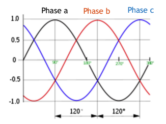

### Phase voltages and neutral

When the three sources share a common connection point, that point is called the **neutral**.

The phase-to-neutral voltages are measured between each phase terminal and neutral. Taking phase A as the reference:

$$
v_{an}(t)=V_m\cos(\omega t)
$$

$$
v_{bn}(t)=V_m\cos(\omega t-120^\circ)
$$

$$
v_{cn}(t)=V_m\cos(\omega t-240^\circ)
$$

Here, $$V_m$$ is the common peak voltage.

- Phase B lags phase A by $$120^\circ$$.
- Phase C lags phase B by $$120^\circ$$.
- The angle $$-240^\circ$$ is equivalent to $$+120^\circ$$.

Using RMS phasors:

$$
\overline V_{an}=V\angle0^\circ,\qquad
\overline V_{bn}=V\angle(-120^\circ),\qquad
\overline V_{cn}=V\angle120^\circ
$$

### Why use three-phase power?

**1. Efficient use of wires**

At the same phase voltage, current capacity, and power factor, a balanced three-phase supply can carry three times the power of one single-phase supply using three wires instead of two.

Compared with three separate single-phase circuits, this reduces conductor requirements and resistive losses.

**2. Currents cancel at neutral**

For balanced sinusoidal phase currents:

$$
i_a(t)+i_b(t)+i_c(t)=0
$$

Therefore, no current flows through the neutral conductor under these ideal balanced conditions. Unbalanced loads can produce neutral current.

**3. Constant total instantaneous power**

Each phase has fluctuating instantaneous power, but the fluctuations cancel when all three phases are added:

$$
p_{\text{total}}(t)=p_a(t)+p_b(t)+p_c(t)=\text{constant}
$$

This applies to balanced sinusoidal operation and helps produce smoother motor operation.

**4. Rotating magnetic field**

Three-phase currents can create a rotating magnetic field, making them useful for electric motors.

> [!tip] Remember
> Balanced sources have equal voltage magnitudes and frequencies, separated by $$120^\circ$$. Balanced loads have equal impedances. Together, they give zero neutral current and constant total instantaneous power.

# Balanced Three-Phase Systems: Star and Delta

> [!note] Notation
> All voltage and current magnitudes below are **RMS values**.
> - **Line voltage:** voltage between two supply lines.
> - **Phase voltage:** voltage across one source winding or load impedance.
> - **Line current:** current in a supply wire.
> - **Phase current:** current through one winding or load impedance.

## 1. Star-Connected Sources

Three-phase sources and loads can be connected in **star (Y or wye)** or **delta**.

In a star connection, one terminal of each phase connects to a common point called the **neutral**.

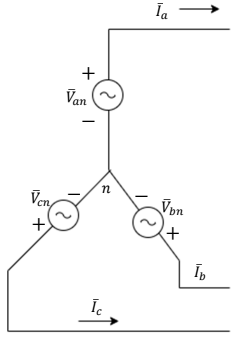

### Phase voltage versus line voltage

- **Phase voltage:** Voltage between one phase terminal and neutral.
- **Line voltage:** Voltage between two phase terminals.

For a balanced source with phase sequence A–B–C:

$$
\overline V_{an}=V_{ph}\angle0^\circ
$$

$$
\overline V_{bn}=V_{ph}\angle(-120^\circ)
$$

$$
\overline V_{cn}=V_{ph}\angle120^\circ
$$

Here, $$V_{ph}$$ is the RMS phase-voltage magnitude.

### Finding line voltages

A line voltage is the **phasor difference** between two phase voltages:

$$
\overline V_{ab}=\overline V_{an}-\overline V_{bn}
$$

$$
\overline V_{bc}=\overline V_{bn}-\overline V_{cn}
$$

$$
\overline V_{ca}=\overline V_{cn}-\overline V_{an}
$$

For example:

$$
\overline V_{ab}
=V_{ph}\left[1-\left(-\frac12-j\frac{\sqrt3}{2}\right)\right]
$$

$$
=V_{ph}\left(\frac32+j\frac{\sqrt3}{2}\right)
=\sqrt3V_{ph}\angle30^\circ
$$

Therefore:

$$
\overline V_{ab}=\sqrt3V_{ph}\angle30^\circ
$$

$$
\overline V_{bc}=\sqrt3V_{ph}\angle(-90^\circ)
$$

$$
\overline V_{ca}=\sqrt3V_{ph}\angle150^\circ
$$

**Key relationships:**

- Line-voltage magnitude is $$\sqrt3$$ times phase-voltage magnitude.
- Each line voltage leads its corresponding phase voltage by $$30^\circ$$ for the A–B–C sequence.
- The three line voltages remain separated by $$120^\circ$$.

For example, $$\overline V_{ab}$$ leads $$\overline V_{an}$$ by $$30^\circ$$.

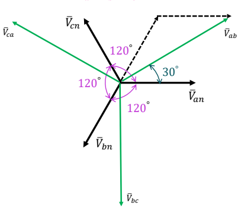

### Line current versus phase current

Each line wire connects directly to one phase branch, so they carry the same current:

$$
I_L=I_{ph}
$$

For a balanced load supplied by balanced voltages, the currents have equal magnitudes and are separated by $$120^\circ$$. Their sum is zero:

$$
\overline I_a+\overline I_b+\overline I_c=0
$$

Therefore, the neutral current is zero under balanced sinusoidal conditions.

### Time-domain line voltages

Converting RMS phasors back to instantaneous voltages:

$$
v_{ab}(t)=\sqrt2\sqrt3V_{ph}\cos(\omega t+30^\circ)
$$

$$
v_{bc}(t)=\sqrt2\sqrt3V_{ph}\cos(\omega t-90^\circ)
$$

$$
v_{ca}(t)=\sqrt2\sqrt3V_{ph}\cos(\omega t+150^\circ)
$$

The factor $$\sqrt3$$ converts phase RMS voltage to line RMS voltage. The factor $$\sqrt2$$ converts RMS voltage to peak voltage.

> [!tip] Remember for a balanced star connection
> $$V_L=\sqrt3V_{ph},\qquad I_L=I_{ph}$$
> Find line voltages by subtracting **phasors**, not just their magnitudes.

## 2. Delta-Connected Sources

In a delta connection, the three sources form a closed triangle. Each source connects directly between two line terminals, so there is no common neutral point.

Therefore, **line voltage equals phase voltage**:

$$
V_L=V_{ph}
$$

Taking the voltage between lines a and b as the reference, for positive phase sequence:

$$
\overline V_{ab}=V_L\angle0^\circ
$$

$$
\overline V_{bc}=V_L\angle-120^\circ
$$

$$
\overline V_{ca}=V_L\angle120^\circ
$$

The corresponding instantaneous voltages are:

$$
v_{ab}(t)=\sqrt2V_L\cos(\omega t)
$$

$$
v_{bc}(t)=\sqrt2V_L\cos(\omega t-120^\circ)
$$

$$
v_{ca}(t)=\sqrt2V_L\cos(\omega t+120^\circ)
$$

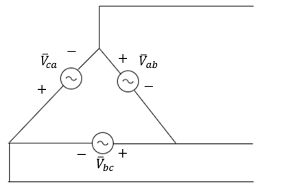

## Balanced Loads

A balanced three-phase load contains **three identical impedances**, connected in star or delta:

$$
Z_a=Z_b=Z_c=|Z|\angle\theta
$$

The impedance angle is the angle between the voltage across a load branch and the current through that same branch:

$$
\theta=\angle\overline V_{ph}-\angle\overline I_{ph}
$$

- Positive angle: inductive load; current lags voltage.
- Negative angle: capacitive load; current leads voltage.
- Zero angle: resistive load; current and voltage are in phase.

For each branch, use Ohm’s law:

$$
\overline I_{ph}=\frac{\overline V_{ph}}{Z}
$$

## 3. Star-Connected Load

Each line feeds one impedance, and the three impedances meet at a common point.

Because the line wire and its impedance carry the same current:

$$
I_L=I_{ph}
$$

For a balanced system:

$$
V_L=\sqrt3V_{ph}
\qquad\Rightarrow\qquad
V_{ph}=\frac{V_L}{\sqrt3}
$$

Therefore, the current magnitude is:

$$
I_L=I_{ph}=\frac{V_L}{\sqrt3|Z_Y|}
$$

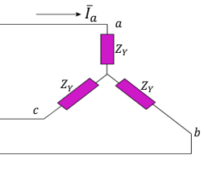

## 4. Delta-Connected Load

Each impedance connects between two lines, so it receives the full line voltage:

$$
V_{ph}=V_L
$$

The current through each impedance is:

$$
I_{ph}=\frac{V_L}{|Z_\Delta|}
$$

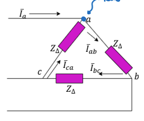

### Phase currents

Taking the a-to-b line voltage as the reference:

$$
\overline I_{ab}=I_{ph}\angle(-\theta)
$$

$$
\overline I_{bc}=I_{ph}\angle(-\theta-120^\circ)
$$

$$
\overline I_{ca}=I_{ph}\angle(-\theta+120^\circ)
$$

### Line currents

At each terminal, the supply current splits between two branches. Kirchhoff’s current law gives:

$$
\overline I_a=\overline I_{ab}-\overline I_{ca}
$$

$$
\overline I_b=\overline I_{bc}-\overline I_{ab}
$$

$$
\overline I_c=\overline I_{ca}-\overline I_{bc}
$$

These are **phasor differences**, so we must account for the current angles.

For example:

$$
\begin{aligned}
\overline I_a
&=I_{ph}e^{-j\theta}\left(1-e^{j120^\circ}\right)\\
&=I_{ph}e^{-j\theta}
\left(\frac32-j\frac{\sqrt3}{2}\right)\\
&=\sqrt3I_{ph}\angle(-\theta-30^\circ)
\end{aligned}
$$

Thus:

$$
\boxed{I_L=\sqrt3I_{ph}}
$$

For positive phase sequence, each line current **lags its corresponding branch current by** $$30^\circ$$:

$$
\overline I_a=\sqrt3I_{ph}\angle(-\theta-30^\circ)
$$

$$
\overline I_b=\sqrt3I_{ph}\angle(-\theta-150^\circ)
$$

$$
\overline I_c=\sqrt3I_{ph}\angle(-\theta+90^\circ)
$$

The three line currents remain separated by $$120^\circ$$ and sum to zero:

$$
\overline I_a+\overline I_b+\overline I_c=0
$$

## 5. Power in Balanced Three-Phase Loads

### Power per phase

Each impedance absorbs active and reactive power:

$$
P_{ph}=V_{ph}I_{ph}\cos\theta
$$

$$
Q_{ph}=V_{ph}I_{ph}\sin\theta
$$

### Total power

Since the three phases are identical, total power is three times the power per phase.

**Active power**, measured in watts:

$$
\boxed{
P=3V_{ph}I_{ph}\cos\theta
=\sqrt3V_LI_L\cos\theta
}
$$

**Reactive power**, measured in VAR:

$$
\boxed{
Q=3V_{ph}I_{ph}\sin\theta
=\sqrt3V_LI_L\sin\theta
}
$$

**Apparent power**, measured in VA:

$$
\boxed{
|S|=\sqrt{P^2+Q^2}
=3V_{ph}I_{ph}
=\sqrt3V_LI_L
}
$$

**Power factor:**

$$
PF=\frac{P}{|S|}=\cos\theta
$$

These line-voltage and line-current formulas work for **both balanced star and balanced delta loads**.

### Complex power

Using the voltage and current of the same load branch:

$$
S=3\overline V_{ph}\overline I_{ph}^{\,*}=P+jQ
$$

Equivalently, using RMS magnitudes:

$$
S=\sqrt3V_LI_L(\cos\theta+j\sin\theta)
$$

> [!warning] Use the correct angle
> The power-factor angle is between a **phase voltage and its corresponding phase current**. It is not generally the angle between a line-to-line voltage and a line current, because their relationship includes an additional $$30^\circ$$ shift.

Although each phase’s instantaneous power fluctuates, the fluctuations cancel in a balanced sinusoidal system. **Total instantaneous three-phase power is constant.**

## 6. Star vs Delta Summary

| Relationship | Star | Delta |
|---|---|---|
| Phase voltage | $$V_{ph}=V_L/\sqrt3$$ | $$V_{ph}=V_L$$ |
| Line current | $$I_L=I_{ph}$$ | $$I_L=\sqrt3I_{ph}$$ |
| Current through one impedance | $$I_{ph}=\frac{V_L}{\sqrt3\lvert Z_Y\rvert}$$ | $$I_{ph}=\frac{V_L}{\lvert Z_\Delta\rvert}$$ |
| Total active power | $$P=\sqrt3V_LI_L\cos\theta$$ | $$P=\sqrt3V_LI_L\cos\theta$$ |

**Memory aid:** Star introduces the square-root-of-three factor in **voltage**; delta introduces it in **current**.

## Star–Delta Impedance Transformations

Star and delta networks can be replaced by **equivalent networks** that draw the same line currents for the same applied terminal voltages.

The individual branch impedances must change when converting between connections.

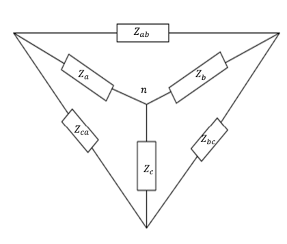

### Star to Delta

Each delta impedance equals the **sum of pairwise products of star impedances, divided by the opposite star impedance**:

$$
Z_{ab}=\frac{Z_aZ_b+Z_bZ_c+Z_cZ_a}{Z_c}
$$

$$
Z_{bc}=\frac{Z_aZ_b+Z_bZ_c+Z_cZ_a}{Z_a}
$$

$$
Z_{ca}=\frac{Z_aZ_b+Z_bZ_c+Z_cZ_a}{Z_b}
$$

For example, the branch between terminals a and b is opposite the star branch connected to terminal c.

For a **balanced load**, all three star impedances are equal, so:

$$
Z_\Delta=\frac{3Z_Y^2}{Z_Y}
$$

$$
\boxed{Z_\Delta=3Z_Y}
$$

### Delta to Star

Each star impedance equals the **product of the two adjacent delta impedances, divided by the sum of all three delta impedances**:

$$
Z_a=\frac{Z_{ab}Z_{ca}}{Z_{ab}+Z_{bc}+Z_{ca}}
$$

$$
Z_b=\frac{Z_{ab}Z_{bc}}{Z_{ab}+Z_{bc}+Z_{ca}}
$$

$$
Z_c=\frac{Z_{bc}Z_{ca}}{Z_{ab}+Z_{bc}+Z_{ca}}
$$

For a **balanced load**:

$$
Z_Y=\frac{Z_\Delta^2}{3Z_\Delta}
$$

$$
\boxed{Z_Y=\frac{Z_\Delta}{3}}
$$

> [!important] When can we use the factor of three?
> Only when the three branch impedances are equal. For an unbalanced network, use the general formulas.
>
> These transformations apply to the full **complex impedances**, including both resistance and reactance.

## Per-Phase Equivalent Circuit

A balanced three-phase circuit can be solved by analysing **just one phase**. The other phases have the same magnitudes, with angles shifted by $$120^\circ$$.

For the method shown in the lecture, express the source and load in **star form**.

### Steps

1. Convert any delta load into an equivalent star load:

$$
Z_Y=\frac{Z_\Delta}{3}
$$

2. Find the source phase-to-neutral voltage.

For positive phase sequence:

$$
\overline V_{an}
=\frac{\overline V_{ab}}{\sqrt3}\angle(-30^\circ)
$$

Thus, its RMS magnitude is:

$$
V_{ph}=\frac{V_L}{\sqrt3}
$$

3. Solve the single-phase circuit using Ohm’s law.

With ideal connecting wires:

$$
\overline I_a=\frac{\overline V_{an}}{Z_Y}
$$

If a line impedance is present, include it in series with the load impedance.

4. Obtain the other line currents by shifting the angle:

$$
\overline I_b=\overline I_a\angle(-120^\circ)
$$

$$
\overline I_c=\overline I_a\angle(+120^\circ)
$$

5. Multiply the power of one phase by three to obtain total power:

$$
S_{\text{total}}
=3\overline V_{an}\overline I_a^{\,*}
$$

> [!note] Hypothetical neutral
> In a balanced system, the source and load neutral points have the same potential. A hypothetical neutral connection can therefore be used for analysis even if no physical neutral wire exists.
>
> After converting a delta load to star, the calculated star branch current is the **original line current**. It is not the original delta branch current.

## Three-Phase Voltage Measurement

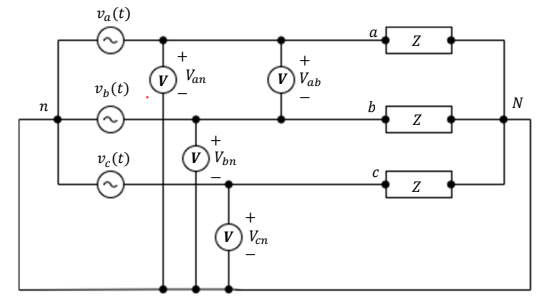

A **voltmeter connects in parallel** across the two points whose voltage difference is being measured.

- Between a line and neutral: measures phase-to-neutral voltage.
- Between two lines: measures line-to-line voltage.

For a balanced star connection:

$$
V_L=\sqrt3V_{ph}
$$

For a delta connection:

$$
V_L=V_{ph}
$$

AC voltmeters display **RMS voltage** for the sinusoidal signals considered here.

## Three-Phase Current Measurement

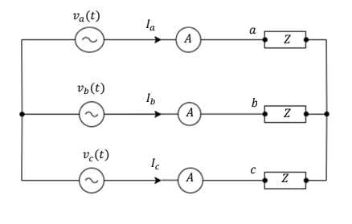

An **ammeter connects in series** with the branch whose current is being measured.

- In a supply line: measures line current.
- In a load branch: measures phase current.

For a star connection:

$$
I_L=I_{ph}
$$

For a balanced delta connection:

$$
I_L=\sqrt3I_{ph}
$$

AC ammeters display **RMS current** for the sinusoidal signals considered here.

## Single-Phase Power Measurement

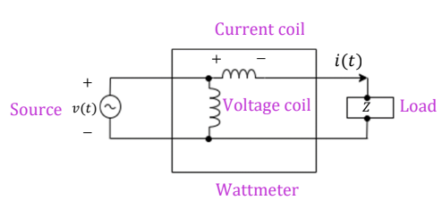

A **wattmeter measures average active power**, in watts:

$$
P=VI\cos\theta
$$

It has two coils:

| Coil | Connection | Quantity sensed |
|---|---|---|
| Voltage coil | In parallel across the load | Load voltage |
| Current coil | In series with the load | Load current |

The wattmeter accounts for the phase difference between voltage and current.

Multiplying the RMS voltmeter and ammeter readings alone gives **apparent power**:

$$
\lvert S\rvert=VI
$$

This equals active power only at unity power factor:

$$
\cos\theta=1
$$

## Three-Phase Power Measurement

The **three-wattmeter method** measures the active power of each phase and adds the readings:

$$
\boxed{P_{\text{total}}=P_A+P_B+P_C}
$$

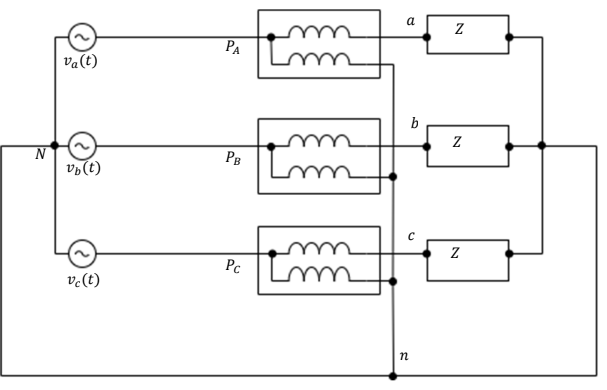

In the star circuit shown:

- Each current coil is in series with its corresponding line.
- Each voltage coil connects between that line and neutral.

For a balanced load, all three readings are equal:

$$
P_A=P_B=P_C
$$

Therefore:

$$
P_{\text{total}}=3P_A
=\sqrt3V_LI_L\cos\theta
$$

For an unbalanced load, the readings may differ. Add the three measured powers; do not assume one reading represents all three phases.

### Three-phase four wire systems
- A fourth wire is used as the neutral wire or a return path.
- In a balanced three-phase system, the neutral current will be equal to zero.
- In an unbalanced three-phase system, the neutral current will not be zero and the neutral wire carries a current.

